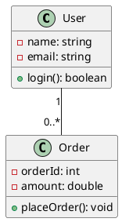

# 16. UML Class Diagrams

## 1. UML Kya Hai?

UML ka full form hai **Unified Modeling Language**.

UML ek standard visual language hai jiska use software system ka design aur structure diagrams ke through represent karne ke liye hota hai.

Simple words mein:

**UML ki help se hum software banane se pehle uska design diagram ke form mein draw kar sakte hain.**

### Example

Maan lo tum ek E-commerce application bana rahe ho.

Usme multiple classes hongi:

- User
- Product
- Order
- Payment
- Cart

In classes ko aur unke relationships ko diagram mein show kar sakte ho.

Isse coding start karne se pehle system ka structure samajh aa jata hai.

---

## 2. UML Ka Use Kyu Karte Hain?

UML use karne ke main reasons:

1. Software ka structure samajhne ke liye.
2. Classes ke relationships show karne ke liye.
3. Coding se pehle system plan karne ke liye.
4. Team members ke saath design communicate karne ke liye.
5. Complex systems ko easily understand karne ke liye.
6. Documentation maintain karne ke liye.

### Real-Life Example

Maan lo tum ek Library Management System bana rahe ho.

Coding start karne se pehle decide karna hoga:

- Book class hogi.
- Student class hogi.
- Librarian class hogi.
- BookIssue class hogi.

UML diagram se in classes aur unke relationships ko represent kar sakte ho.

---

## 3. UML Diagrams Ke Types

UML diagrams ko broadly 2 categories mein divide kiya jata hai.

### 1. Structural Diagrams

Ye system ki static structure show karte hain.

Matlab system mein kaun-kaun se components/classes hain aur unka relationship kya hai.

Examples:

- Class Diagram
- Object Diagram
- Component Diagram
- Deployment Diagram
- Package Diagram

### 2. Behavioral Diagrams

Ye system ka behaviour aur activities show karte hain.

Matlab system kaam kaise karta hai aur objects ka interaction kaise hota hai.

Examples:

- Use Case Diagram
- Activity Diagram
- Sequence Diagram
- State Machine Diagram

### Difference

| Structural Diagram                  | Behavioral Diagram                     |
| ----------------------------------- | -------------------------------------- |
| System ki structure show karta hai. | System ka behaviour show karta hai.    |
| Classes aur components par focus.   | Activities aur interactions par focus. |
| Static view deta hai.               | Dynamic view deta hai.                 |
| Example: Class Diagram              | Example: Sequence Diagram              |

**Note:** UML mein total 14 standard diagram types hote hain, jo Structural aur Behavioral categories mein divide hote hain.

---

## 4. Class Diagram Kya Hai?

Class Diagram UML ka ek structural diagram hai.

Ye software ki classes, unke attributes, methods aur relationships ko represent karta hai.

Simple words mein:

**Class Diagram batata hai ki system mein kaun-kaun si classes hongi, unke andar kya data aur methods honge, aur classes ek-dusre se kaise connected hongi.**

### Example

Maan lo ek Student class hai.

Isme:

Attributes:

- name
- age
- rollNumber

Methods:

- study()
- attendClass()

Class Diagram in sabko visually show karega.

---

## 5. Class Diagram Ka Structure

Ek UML class ko generally 3 sections mein divide kiya jata hai.

```text
+--------------------------+
|          Student         |
+--------------------------+
| - name: string           |
| - age: int               |
| - rollNumber: int        |
+--------------------------+
| + study(): void          |
| + attendClass(): void    |
+--------------------------+
```

### Section 1: Class Name

Sabse upar class ka naam hota hai.

Example:

```text
Student
```

### Section 2: Attributes

Attributes class ka data ya properties hoti hain.

Example:

```text
- name: string
- age: int
- rollNumber: int
```

### Section 3: Methods

Methods class ke functions hote hain.

Example:

```text
+ study(): void
+ attendClass(): void
```

---

## 6. UML Visibility Symbols

UML mein visibility batane ke liye kuch special symbols use hote hain.

| Symbol | Visibility | Meaning                          |
| ------ | ---------- | -------------------------------- |
| `+`    | Public     | Bahar se access ho sakta hai     |
| `-`    | Private    | Sirf class ke andar access       |
| `#`    | Protected  | Class aur subclasses mein access |
| `~`    | Package    | Same package ke andar access     |

### Example

```text
+--------------------------+
|          User            |
+--------------------------+
| - password: string       |
| + username: string       |
| # email: string          |
+--------------------------+
| + login(): boolean       |
| - validatePassword()     |
| # updateProfile(): void  |
+--------------------------+
```

Explanation:

- `password` private hai.
- `username` public hai.
- `email` protected hai.
- `login()` public method hai.
- `validatePassword()` private method hai.
- `updateProfile()` protected method hai.

**Note:** JavaScript mein `#password` true private field hota hai. UML ka `-` symbol visibility show karta hai; ye language-specific syntax nahi hai.

---

## 7. UML Attributes Ka Syntax

UML mein attribute generally is format mein likha jata hai:

```text
visibility name: dataType
```

Example:

```text
- name: string
- age: int
- salary: double
```

Meaning:

- `-` = Private
- `name` = Attribute ka naam
- `string` = Data type

### UML Methods Ka Syntax

```text
visibility methodName(parameters): returnType
```

Example:

```text
+ login(username: string, password: string): boolean
```

Meaning:

- `+` = Public
- `login` = Method name
- `username` aur `password` = Parameters
- `boolean` = Return type

---

## 8. Classes Ke Beech Relationships

Class Diagram ka sabse important part relationships hain.

UML mein common relationships:

1. Association
2. Aggregation
3. Composition
4. Inheritance / Generalization
5. Dependency
6. Realization

### 1. Association

Association ka matlab hai do classes ke objects ke beech relationship.

Example:

Student aur Teacher.

```text
+-----------+       +-----------+
|  Student  |-------|  Teacher  |
+-----------+       +-----------+
```

Meaning:

Student aur Teacher ek-dusre se associated hain.

Example: Teacher students ko teach karta hai.

### 2. Aggregation

Aggregation ek weak whole-part relationship hai.

Isme ek class doosri class ko contain ya use karti hai, lekin part independently exist kar sakta hai.

Example:

Department aur Professor.

```text
+------------+       +-----------+
| Department |◇------| Professor |
+------------+       +-----------+
```

`◇` = Hollow Diamond

Meaning:

Department ke saath Professor associated hai, lekin Department delete hone par Professor ka existence zaroori nahi ki end ho.

### 3. Composition

Composition ek strong whole-part relationship hai.

Isme part ka lifecycle whole ke saath strongly connected hota hai.

Example:

House aur Room.

```text
+-------+       +------+
| House |◆------| Room |
+-------+       +------+
```

`◆` = Filled Diamond

Meaning:

Is model mein Room ko House ka strongly owned part maana gaya hai.

**Important:** Aggregation aur Composition ka exact lifecycle behaviour application ke domain model par depend karta hai. Sirf diamond symbol dekhkar real database deletion behaviour assume nahi karna chahiye.

### 4. Inheritance / Generalization

Inheritance mein child class parent class ke features inherit karti hai.

Example:

```text
       +--------+
       |  Animal|
       +--------+
            △
            |
       +--------+
       |   Dog  |
       +--------+
```

`△` = Hollow Triangle

Meaning:

Dog, Animal ka child class hai.

### 5. Dependency

Dependency ka matlab hai ek class doosri class ko temporarily use karti hai.

Example:

```text
+-----------+      - - - - >     +----------+
|  Report   |                     | Printer  |
+-----------+                     +----------+
```

Dashed arrow dependency show karta hai.

Meaning:

Report class ko print karne ke liye Printer class ki zaroorat ho sakti hai.

### 6. Realization

Realization tab hota hai jab class kisi interface ya contract ko implement karti hai.

Example:

```text
+------------------+
|  PaymentGateway  |
|   <<interface>>  |
+------------------+
          △
          |
          |
+------------------+
| RazorpayPayment  |
+------------------+
```

Dashed line aur hollow triangle realization show karte hain.

Meaning:

RazorpayPayment, PaymentGateway interface implement karta hai.

---

## 9. Multiplicity Kya Hai?

Multiplicity batati hai ki ek class ke kitne objects doosri class ke objects se connected ho sakte hain.

Common multiplicity symbols:

| Symbol | Meaning              |
| ------ | -------------------- |
| `1`    | Exactly one          |
| `0..1` | Zero or one          |
| `*`    | Zero or more         |
| `0..*` | Zero or more         |
| `1..*` | One or more          |
| `2..5` | Minimum 2, maximum 5 |

### Example: One-to-Many

Ek Teacher multiple Students ko teach kar sakta hai.

```text
+---------+  1       0..*  +---------+
| Teacher |---------------| Student |
+---------+                +---------+
```

Meaning:

- Ek Teacher ke zero ya multiple Students ho sakte hain.
- Har Student ka is model mein exactly one Teacher hai.

### Example: One-to-One

```text
+--------+  1       1  +---------+
| Person |-------------| Passport|
+--------+              +---------+
```

### Example: Many-to-Many

```text
+--------+  0..*    0..*  +--------+
| Student|----------------| Course |
+--------+                 +--------+
```

Ek Student multiple courses le sakta hai aur ek Course mein multiple Students ho sakte hain.

---

## 10. Complete Example: Library Management System

Ab ek complete simple Class Diagram samjhte hain.

Classes:

- Library
- Book
- Member
- Librarian
- BookIssue

### Class Diagram

```text
+------------------+
|      Library     |
+------------------+
| - name: string   |
+------------------+
| + addBook(): void|
+------------------+
         |
         | 1
         |
         | 0..*
+------------------+
|       Book       |
+------------------+
| - title: string  |
| - isbn: string   |
| - available: bool|
+------------------+
| + borrow(): void |
| + return(): void |
+------------------+

+------------------+
|      Member      |
+------------------+
| - memberId: int  |
| - name: string   |
+------------------+
| + borrowBook()   |
+------------------+

+------------------+
|    Librarian     |
+------------------+
| - employeeId:int |
+------------------+
| + issueBook()    |
+------------------+

+------------------+
|    BookIssue     |
+------------------+
| - issueDate      |
| - returnDate     |
+------------------+
| + closeIssue()   |
+------------------+
```

### Explanation

1. Library mein multiple Books ho sakti hain.
2. Member books borrow kar sakta hai.
3. Librarian book issue kar sakta hai.
4. BookIssue issue aur return details store karta hai.

Ye ek simplified conceptual design hai. Actual system mein availability, multiple copies aur reservations ke liye additional classes ki zaroorat ho sakti hai.

---

## 11. Class Diagram Aur Object Diagram Mein Difference

| Class Diagram                                    | Object Diagram                                 |
| ------------------------------------------------ | ---------------------------------------------- |
| Classes show karta hai.                          | Objects show karta hai.                        |
| Static structure ka general design.              | Kisi particular moment ka object snapshot.     |
| Class names, attributes, methods show karta hai. | Object names aur actual values show karta hai. |
| Example: Student class                           | Example: `student1: Student`                   |

### Example

Class:

```text
+----------------+
|    Student     |
+----------------+
| name: string   |
| age: int       |
+----------------+
```

Object:

```text
+----------------------+
| student1: Student    |
+----------------------+
| name = "Rahul"       |
| age = 22             |
+----------------------+
```

---

## 12. UML Class Diagram Tools

Class diagrams draw karne ke liye kuch useful tools:

1. Draw.io (diagrams.net)
2. Lucidchart
3. PlantUML
4. StarUML
5. Visual Paradigm

### VS Code Mein PlantUML

PlantUML text ke through UML diagrams create karne deta hai.

Example:



Is example mein:

- User class hai.
- Order class hai.
- Ek User ke multiple Orders ho sakte hain.

---

## 13. MERN Stack Mein Class Diagram Ka Use

MERN stack mein class diagrams ka use application ka object-oriented structure plan karne mein kar sakte ho.

Example: E-commerce application.

Possible classes:

- User
- Product
- Cart
- Order
- Payment
- Review

Inke attributes, methods aur relationships ko class diagram mein show kar sakte ho.

Important:

MERN applications mein har jagah traditional classes use karna compulsory nahi hai. JavaScript mein functions, objects, Mongoose schemas aur modules bhi use hote hain.

Class Diagram ek design/modeling tool hai, kisi particular programming language ki requirement nahi.

---

## 14. Advantages of Class Diagram

1. System ka structure clearly samajh aata hai.
2. Coding se pehle design plan kar sakte hain.
3. Classes aur relationships identify kar sakte hain.
4. Team communication easy hoti hai.
5. Documentation improve hoti hai.
6. Complex system ko understand karna easy hota hai.
7. LLD interviews mein useful hai.

## 15. Common Mistakes

| Mistake                                      | Correct Approach                        |
| -------------------------------------------- | --------------------------------------- |
| Attributes aur methods mix karna             | Separate compartments rakho             |
| Wrong visibility symbols use karna           | `+`, `-`, `#`, `~` samjho               |
| Aggregation aur Composition ko same samajhna | Lifecycle relationship samjho           |
| Multiplicity ignore karna                    | Required cardinality show karo          |
| Har class ko connect kar dena                | Sirf meaningful relationships show karo |
| Diagram ko unnecessarily complex banana      | Simple aur readable design rakho        |
| Class Diagram ko flowchart samajhna          | Class Diagram structure show karta hai  |

---

## 16. Interview Questions and Answers

### Q1. What is UML?

UML ek standard visual modeling language hai jo software system ka design diagrams ke through represent karti hai.

### Q2. What is a Class Diagram?

Class Diagram ek structural UML diagram hai jo classes, attributes, methods aur relationships show karta hai.

### Q3. What are the main sections of a class box?

Class Name, Attributes aur Methods.

### Q4. What does + mean in UML?

Public visibility.

### Q5. What does - mean in UML?

Private visibility.

### Q6. What is Aggregation?

Weak whole-part relationship jahan part independently exist kar sakta hai.

### Q7. What is Composition?

Strong whole-part relationship jahan part ka lifecycle whole ke saath closely connected hota hai.

### Q8. What is Multiplicity?

Multiplicity batati hai ki ek class ke kitne objects doosri class ke objects se connected ho sakte hain.

### Q9. What is the difference between Class Diagram and Object Diagram?

Class Diagram general class structure show karta hai, jabki Object Diagram actual objects aur unki values ka snapshot show karta hai.

### Q10. Which UML tool can be used in VS Code?

PlantUML extension ke through UML diagrams create kar sakte hain.

---

## 17. Practice Tasks

### Task 1: Student Management System

Classes banao:

- Student
- Teacher
- Course

Attributes aur methods define karo.

Relationships aur multiplicity show karo.

### Task 2: E-commerce System

Classes banao:

- User
- Product
- Cart
- Order
- Payment

Unke beech relationships show karo.

### Task 3: Library Management System

Classes banao:

- Library
- Book
- Member
- Librarian
- BookIssue

Complete Class Diagram draw karo.

### Task 4: PlantUML Practice

VS Code mein PlantUML use karke Student aur Course ka class diagram banao.

---

## 18. Quick Revision

- UML = Unified Modeling Language.
- UML software design ko visually represent karta hai.
- Class Diagram ek structural diagram hai.
- Class box ke 3 sections: Name, Attributes, Methods.
- `+` = Public.
- `-` = Private.
- `#` = Protected.
- `~` = Package.
- Association = General relationship.
- Aggregation = Weak whole-part relationship.
- Composition = Strong whole-part relationship.
- Generalization = Inheritance.
- Dependency = Uses relationship.
- Realization = Interface implementation.
- Multiplicity = Objects ke relationship ki quantity.
- Class Diagram coding se pehle system ka structure plan karne mein help karta hai.

---

## 19. Topic Completion Checklist

- [ ] UML ka meaning samajh aa gaya.
- [ ] Structural aur Behavioral diagrams samajh aa gaye.
- [ ] Class Diagram ka structure samajh aa gaya.
- [ ] Visibility symbols samajh aa gaye.
- [ ] Attributes aur Methods ka syntax samajh aa gaya.
- [ ] 6 relationships samajh aa gaye.
- [ ] Multiplicity samajh aa gayi.
- [ ] Class Diagram aur Object Diagram ka difference samajh aa gaya.
- [ ] PlantUML example samajh aa gaya.
- [ ] Practice diagrams bana liye.

**Topic 16 Complete: UML Class Diagrams.**
