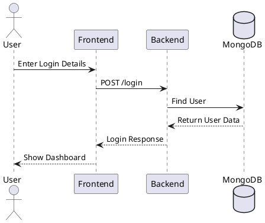
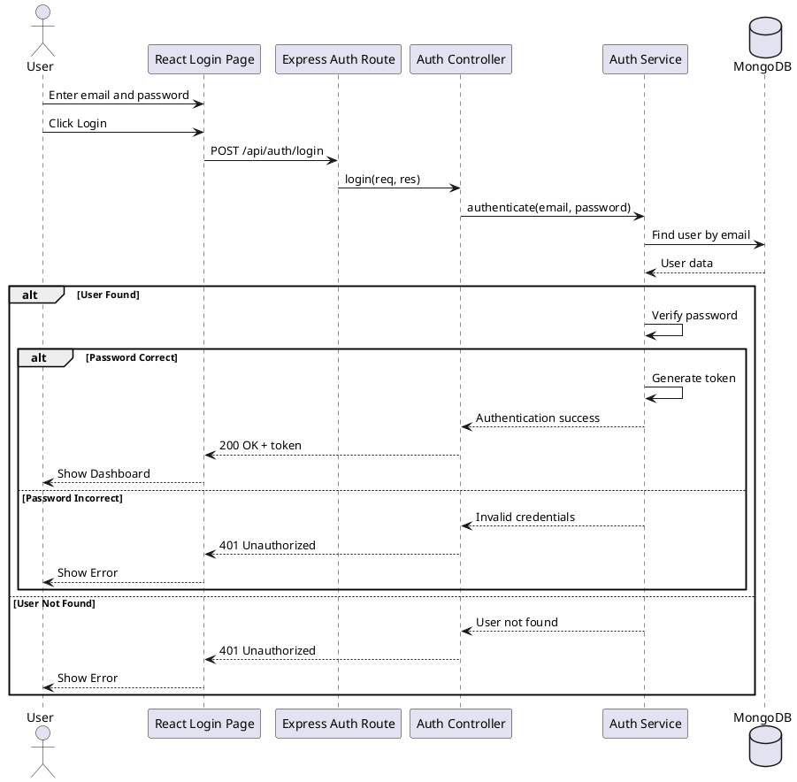

# 17. UML Sequence Diagrams

## 1. UML Sequence Diagram kya hota hai?

UML ka full form hai **Unified Modeling Language**.

Sequence Diagram UML ka ek **Behavioral Diagram** hai. Iska use ye dikhane ke liye hota hai ki kisi particular task ko complete karne ke liye different objects ya components ek-dusre ke saath kis order mein communicate karte hain.

Simple language mein:

Sequence Diagram batata hai:

- System mein kaun-kaun participate kar raha hai?
- Kaun kisko message bhej raha hai?
- Messages kis order mein ja rahe hain?
- Ek object doosre object se kya response receive kar raha hai?
- Pura process kaise complete hota hai?

### Real-life example

Maan lo tum kisi website par login karte ho.

1. User email aur password enter karta hai.
2. React frontend login request bhejta hai.
3. Express backend request receive karta hai.
4. Backend MongoDB mein user ko search karta hai.
5. Password verify hota hai.
6. Backend login response frontend ko bhejta hai.
7. User dashboard par pahunch jata hai.

Sequence Diagram isi complete communication ko visual form mein show karta hai.

## 2. Sequence Diagram ka main purpose

Sequence Diagram ka main purpose hai system ke andar hone wali communication ko time order mein samajhna.

Isse developer ko pata chalta hai:

- Request kahan se start ho rahi hai.
- Request kin components se pass ho rahi hai.
- Kaunsa component kis component ko call kar raha hai.
- Response kis direction mein aa raha hai.
- Error ya alternate condition mein kya hoga.

## 3. Sequence Diagram ki direction

Sequence Diagram mein do important directions hoti hain:

| Direction                  | Meaning                |
| -------------------------- | ---------------------- |
| Horizontal (Left to Right) | Participants / Objects |
| Vertical (Top to Bottom)   | Time / Sequence        |

**Important:** Time diagram mein top se bottom ki taraf move karta hai.

Example:

```text
User       Frontend       Backend       Database
 |             |              |              |
 |-----------> |              |              |
 |             |------------> |              |
 |             |              |------------> |
 |             |              |<------------ |
 |             |<------------ |              |
 |<----------- |              |              |
```

Yahan communication upar se neeche ki taraf progress karti hai.

## 4. Sequence Diagram ke main components

Sequence Diagram ko samajhne ke liye ye components important hain.

### 4.1 Actor

Actor wo person ya external system hota hai jo system ke saath interact karta hai.

Example:

- User
- Admin
- Customer
- Payment Gateway (external system)

Diagram mein actor ko generally stick figure se show kiya jata hai.

### 4.2 Participant / Object

Participant wo object, component ya system part hota hai jo interaction mein participate karta hai.

Example:

- LoginPage
- AuthController
- AuthService
- UserModel
- MongoDB

Participant ko diagram ke top par rectangle ke andar naam likhkar show kiya jata hai.

### 4.3 Lifeline

Lifeline ek vertical dashed line hoti hai jo participant ke neeche draw ki jati hai.

Ye batati hai ki participant interaction mein present hai.

Example:

```text
  User
   |
   |
   :
   :
   :
```

Dashed vertical line ko Lifeline kehte hain.

### 4.4 Activation Bar / Execution Specification

Activation bar ek thin rectangle hota hai jo lifeline ke upar show hota hai.

Ye batata hai ki participant kisi operation ko execute kar raha hai.

Example:

```text
  Backend
     |
    [ ]
    [ ]  <- Activation Bar
    [ ]
     |
     :
```

Simple meaning: Jab backend koi function execute kar raha hota hai, tab uska activation bar show kiya ja sakta hai.

## 5. Messages in Sequence Diagram

Messages wo arrows hain jo ek participant se doosre participant tak communication show karte hain.

UML Sequence Diagram mein different types ke messages hote hain.

### 5.1 Synchronous Message

Jab sender kisi operation ko call karta hai aur us operation ke complete hone ya response aane ka wait karta hai, use synchronous message kehte hain.

Example:

```text
Frontend --------> Backend
          Login()
```

Meaning:

- Frontend backend ko login request bhejta hai.
- Synchronous interaction mein caller completion ka wait karta hai.

Isko generally solid line aur filled arrowhead se show kiya jata hai.

### 5.2 Asynchronous Message

Jab sender message bhejne ke baad receiver ke operation ke complete hone ka wait nahi karta, use asynchronous message kehte hain.

Example:

```text
OrderService --------> EmailService
                 SendEmail()
```

Meaning:

- OrderService email bhejne ka task EmailService ko deta hai.
- Sender apna kaam continue kar sakta hai.

Isko generally solid line aur open arrowhead se show kiya jata hai.

### 5.3 Return Message

Jab receiver apne operation ka result sender ko return karta hai, use return message kehte hain.

Example:

```text
Frontend < - - - - Backend
             Response
```

Isko dashed line aur open arrowhead se show kiya jata hai.

**Note:** UML mein return message ko har baar draw karna compulsory nahi hai. Jab response important ho tab show kar sakte hain.

### 5.4 Self Message

Jab koi participant khud apne kisi operation ya method ko call karta hai, use self-message kehte hain.

Example:

```text
AuthService
    |
    |----> ValidatePassword()
    |<----
    |
```

Example: AuthService apne andar password validation method call karta hai.

### 5.5 Create Message

Jab interaction ke dauran ek naya object create hota hai, use create message se show kar sakte hain.

Example:

```text
OrderController -----> Order
                       (New Object)
```

New object ki lifeline uske creation point se start hoti hai.

### 5.6 Delete Message

Jab interaction ke dauran kisi object ka lifecycle end hota hai, to uski lifeline ke end par X symbol show kiya ja sakta hai.

Isse destruction message ke through represent kar sakte hain.

## 6. Combined Fragments

Combined Fragments ka use tab hota hai jab sequence diagram mein conditions, loops ya parallel interactions show karne hon.

Important fragments:

### 6.1 ALT Fragment

`alt` ka full meaning hai Alternative.

Jab system mein condition ke according do ya zyada possible paths hon, tab `alt` use hota hai.

Example: Login successful ya login failed.

```text
          ALT
     [Password Correct]
          Login Success

     [Password Incorrect]
          Login Failed
```

Meaning:

- Password correct hai to login success.
- Password incorrect hai to error response.

Dono conditions ek hi execution mein simultaneously execute nahi hoti; condition ke according ek branch select hoti hai.

### 6.2 OPT Fragment

`opt` ka full meaning hai Optional.

Jab koi action sirf condition true hone par execute hota hai, tab `opt` use hota hai.

Example:

```text
OPT [User selected Remember Me]
       Save Remember Me Preference
```

Meaning: Agar user Remember Me select karta hai tabhi ye action execute hoga.

### 6.3 LOOP Fragment

Jab koi action repeatedly execute hota hai, tab `loop` use hota hai.

Example:

```text
LOOP [For every product]
       Add Product to Cart
```

Meaning: Har product ke liye ye action repeat ho sakta hai.

### 6.4 PAR Fragment

`par` ka full meaning hai Parallel.

Jab multiple interactions parallel mein execute ho sakte hain, tab `par` use hota hai.

Example:

- Email notification send karna.
- SMS notification send karna.

Dono independent tasks parallel execute ho sakte hain.

## 7. Guards / Conditions

Combined fragments mein square brackets ke andar conditions likhi jati hain. Inhe guard conditions kehte hain.

Examples:

```text
[passwordCorrect]
[userIsAdmin]
[cartIsNotEmpty]
[paymentSuccessful]
```

Ye conditions decide karti hain ki kaunsa interaction execute hoga.

## 8. MERN Stack mein Sequence Diagram

MERN Stack mein:

- M = MongoDB
- E = Express.js
- R = React.js
- N = Node.js

Login process ka sequence diagram samajhte hain.

### Login Flow

1. User React Login Page par email aur password enter karta hai.
2. React frontend Express API ko request bhejta hai.
3. Express Auth Route request receive karta hai.
4. Auth Controller request process karta hai.
5. Auth Service login logic execute karta hai.
6. User Repository / Model MongoDB se user data fetch karta hai.
7. Auth Service password verify karta hai.
8. Backend authentication result aur zarurat ke according token return karta hai.
9. React frontend response receive karta hai.
10. Login successful hone par dashboard show hota hai.

### Diagram

```text
User
 |
 | Enter Email & Password
 v
React Login Page
 |
 | POST /api/auth/login
 v
Express Auth Route
 |
 | Call Controller
 v
Auth Controller
 |
 | Call Login Service
 v
Auth Service
 |
 | Find User
 v
MongoDB
 |
 | Return User Data
 v
Auth Service
 |
 | Verify Password
 |
 | Generate Token (if valid)
 v
Auth Controller
 |
 | Send Response
 v
React Login Page
 |
 | Show Dashboard / Error
 v
User
```

**Important:** Ye conceptual flow hai. Real project mein controller aur service ka separation optional hai; chhote projects mein login logic controller mein bhi ho sakta hai.

## 9. PlantUML se Sequence Diagram banana

PlantUML ek tool hai jisse text code likhkar UML diagrams generate kar sakte hain.

### Basic Syntax



### Important Symbols

| Symbol    | Meaning                |
| --------- | ---------------------- |
| `->`      | Synchronous message    |
| `->>`     | Asynchronous message   |
| `-->`     | Return message         |
| `++`      | Activate participant   |
| `--`      | Deactivate participant |
| `alt`     | Alternative condition  |
| `opt`     | Optional interaction   |
| `loop`    | Repeated interaction   |
| `par`     | Parallel interaction   |
| `create`  | Create participant     |
| `destroy` | Destroy participant    |

PlantUML ka syntax use karke tum VS Code mein diagram ka code likh sakte ho. Diagram render karne ke liye compatible PlantUML extension ya rendering setup chahiye.

## 10. Complete Login Sequence Diagram (PlantUML)



Is diagram mein `alt` fragment successful aur unsuccessful login ke different paths show karta hai.

**Security note:** Real applications mein user existence aur password errors ko carefully handle kiya jata hai. Often same generic login error diya jata hai, taaki attacker ko account existence ka pata na chale.

## 11. Sequence Diagram vs Class Diagram

| Sequence Diagram                    | Class Diagram                            |
| ----------------------------------- | ---------------------------------------- |
| Behavioral diagram                  | Structural diagram                       |
| Interaction show karta hai          | Classes aur relationships show karta hai |
| Time order important hota hai       | Time order important nahi hota           |
| Messages show karta hai             | Attributes aur methods show karta hai    |
| Runtime behavior samajhne mein help | System structure samajhne mein help      |

Example:

- Class Diagram: User, Order aur Product classes ka structure.
- Sequence Diagram: User order place karta hai to objects kaise communicate karte hain.

## 12. Sequence Diagram vs Activity Diagram

| Sequence Diagram                              | Activity Diagram                        |
| --------------------------------------------- | --------------------------------------- |
| Objects ke beech communication show karta hai | Workflow / activities show karta hai    |
| Participants important hain                   | Activities aur decisions important hain |
| Messages show karta hai                       | Actions aur control flow show karta hai |
| Time order dikhata hai                        | Process flow dikhata hai                |

## 13. Sequence Diagram vs Use Case Diagram

| Sequence Diagram                        | Use Case Diagram                       |
| --------------------------------------- | -------------------------------------- |
| Detailed interaction show karta hai     | System ki functionality show karta hai |
| Messages aur participants hote hain     | Actors aur use cases hote hain         |
| Internal communication samajhne ke liye | System kya karta hai samajhne ke liye  |

## 14. Sequence Diagram ke Advantages

1. Communication flow clear hota hai.
2. Backend aur frontend interaction samajhne mein help milti hai.
3. Complex process ko visualize kar sakte hain.
4. Error handling aur alternate flows samajh aate hain.
5. Team members ke beech communication improve hota hai.
6. Coding start karne se pehle design plan kar sakte hain.

## 15. Sequence Diagram ki Limitations

1. Bahut complex system mein diagram lengthy ho sakta hai.
2. Har implementation detail show karna practical nahi hota.
3. System mein changes hone par diagram update karna padta hai.
4. Ye database ka complete schema ya class structure nahi batata.

## 16. Sequence Diagram banate waqt common mistakes

1. Time direction ko left-to-right samajhna. Correct: Time top-to-bottom hota hai.
2. Lifeline aur activation bar ko same samajhna.
3. Return message aur request message ko confuse karna.
4. Ek diagram mein bahut saare unrelated scenarios add karna.
5. Har chhote function call ko diagram mein add kar dena.
6. `alt` aur `opt` ka incorrect use karna.
7. Synchronous aur asynchronous messages ko confuse karna.

**Best Practice:** Ek Sequence Diagram mein ek specific scenario ya use case ko clearly represent karo.

## 17. Interview Questions & Answers

### Q1. What is a UML Sequence Diagram?

**Answer:** UML Sequence Diagram ek behavioral diagram hai jo show karta hai ki different objects ya participants time ke order mein messages exchange karke kisi task ko kaise complete karte hain.

### Q2. What is a Lifeline?

**Answer:** Lifeline ek vertical dashed line hoti hai jo participant ke interaction mein present hone ko represent karti hai.

### Q3. What is an Activation Bar?

**Answer:** Activation Bar batata hai ki participant kisi operation ko execute kar raha hai.

### Q4. What is a Synchronous Message?

**Answer:** Synchronous message mein sender operation call karta hai aur uske complete hone ka wait karta hai.

### Q5. What is an Asynchronous Message?

**Answer:** Asynchronous message mein sender message bhejne ke baad receiver ke operation complete hone ka wait nahi karta.

### Q6. What is an ALT Fragment?

**Answer:** ALT fragment conditions ke according alternative interaction paths represent karta hai.

### Q7. What is an OPT Fragment?

**Answer:** OPT fragment optional interaction represent karta hai jo condition true hone par execute hota hai.

### Q8. What is a LOOP Fragment?

**Answer:** LOOP fragment repeated interaction ko represent karta hai.

### Q9. What is the difference between Class Diagram and Sequence Diagram?

**Answer:** Class Diagram system ki static structure show karta hai, jabki Sequence Diagram objects ke beech time-ordered interaction show karta hai.

### Q10. Is every return message compulsory in a Sequence Diagram?

**Answer:** Nahi. Return messages optional hote hain. Jab response important ho tab show kiye ja sakte hain.

## 18. Practical Tasks

### Task 1: Login Sequence Diagram

Ek login system ka sequence diagram banao jisme:

- User
- React Login Page
- Express Backend
- MongoDB

Login success aur failure dono conditions show karo.

### Task 2: E-commerce Order Sequence Diagram

Ek order placement ka diagram banao:

1. User product select karta hai.
2. Frontend backend ko request bhejta hai.
3. Backend product availability check karta hai.
4. Order create hota hai.
5. Payment Gateway payment process karta hai.
6. User ko order confirmation milta hai.

Payment fail hone ka alternate flow bhi show karo.

### Task 3: Password Reset Sequence Diagram

Ek password reset flow banao:

1. User email enter karta hai.
2. Backend user ko find karta hai.
3. Reset token generate hota hai.
4. Email service reset link send karti hai.
5. User new password set karta hai.
6. Backend password update karta hai.

## 19. Quick Revision

| Term                 | Meaning                           |
| -------------------- | --------------------------------- |
| Sequence Diagram     | Objects ke beech interaction      |
| Actor                | External user / system            |
| Participant          | Interaction mein involved object  |
| Lifeline             | Vertical dashed line              |
| Activation Bar       | Execution duration show karta hai |
| Synchronous Message  | Sender waits                      |
| Asynchronous Message | Sender does not wait              |
| Return Message       | Response show karta hai           |
| Self Message         | Object khud ko call karta hai     |
| ALT                  | Alternative conditions            |
| OPT                  | Optional interaction              |
| LOOP                 | Repeated interaction              |
| PAR                  | Parallel interactions             |

### Remember These Points

- Sequence Diagram ek Behavioral UML Diagram hai.
- Participants horizontally arrange hote hain.
- Time top-to-bottom move karta hai.
- Lifeline vertical dashed line hoti hai.
- Messages arrows se represent hote hain.
- `alt`, `opt`, `loop` important combined fragments hain.
- MERN applications mein login, signup, order aur payment flow design karne mein useful hai.

## 20. Topic Completion Checklist

- [ ] Sequence Diagram ka meaning samajh liya.
- [ ] Actor aur Participant samajh liya.
- [ ] Lifeline aur Activation Bar samajh liya.
- [ ] Synchronous aur Asynchronous messages samajh liye.
- [ ] Return aur Self messages samajh liye.
- [ ] ALT, OPT, LOOP aur PAR samajh liye.
- [ ] MERN login flow samajh liya.
- [ ] PlantUML syntax samajh liya.
- [ ] Practical tasks complete kar liye.
- [ ] Interview questions revise kar liye.

**Topic 17 Complete: UML Sequence Diagrams**
