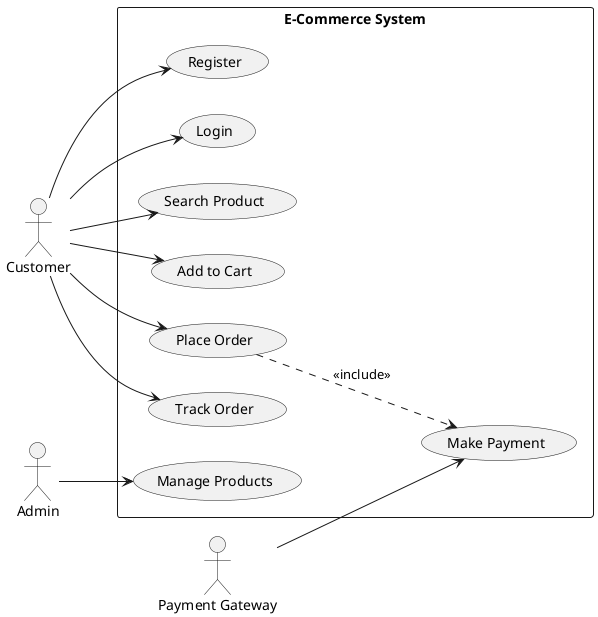
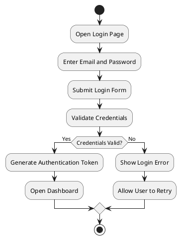
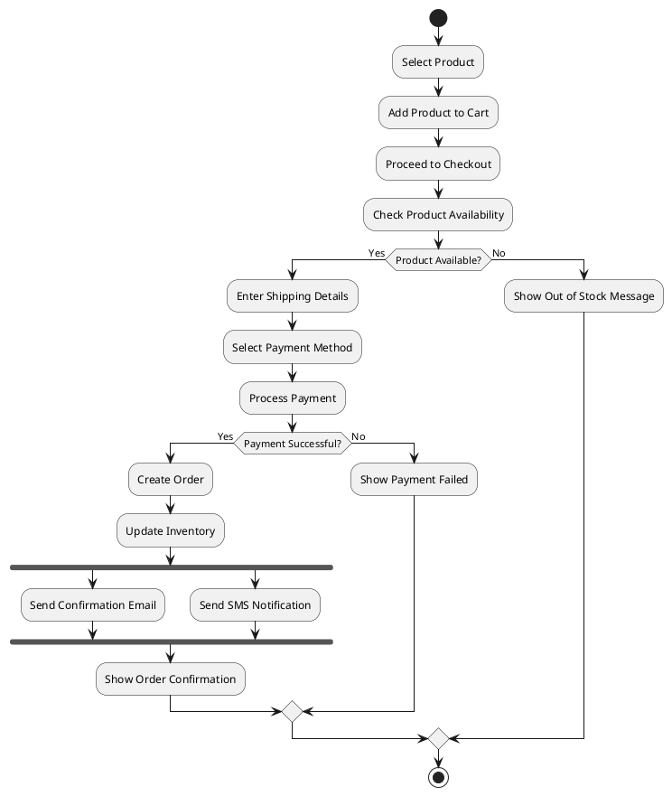

# 18. Use Case & Activity Diagrams

# PART 1: USE CASE DIAGRAM

## 1. Use Case Diagram kya hota hai?

Use Case Diagram UML ka ek **Behavioral Diagram** hai.

Ye represent karta hai ki:

- System ko kaun use karega?
- System mein kaun-kaun si functionalities available hain?
- Kaunsa actor kis functionality ko use kar sakta hai?
- External users aur system ke beech kya interaction hoga?

Simple language mein:

**Use Case Diagram batata hai ki system kya-kya kaam kar sakta hai aur kaun un kaamon ko perform kar sakta hai.**

### Real-life Example

Maan lo tum ek E-commerce website bana rahe ho.

Is website mein:

- Customer login kar sakta hai.
- Customer products search kar sakta hai.
- Customer order place kar sakta hai.
- Customer payment kar sakta hai.
- Admin products add kar sakta hai.
- Admin orders manage kar sakta hai.

Ye saari functionalities Use Case Diagram mein represent ki ja sakti hain.

## 2. Use Case Diagram ke Components

Use Case Diagram ke important components:

1. Actor
2. Use Case
3. System Boundary
4. Association
5. Include Relationship
6. Extend Relationship
7. Generalization

## 3. Actor kya hota hai?

Actor wo person, role ya external system hota hai jo hamare system ke saath interact karta hai.

Example:

- Customer
- Admin
- Seller
- Payment Gateway
- Delivery Partner

Actor system ke bahar hota hai.

Actor ko generally stick figure se represent kiya jata hai.

Example:

```text
   O
  /|\
  / \
 Actor
```

**Important:** Actor hamesha human hona zaroori nahi hai. External software ya another system bhi actor ho sakta hai.

## 4. Use Case kya hota hai?

Use Case system ki ek functionality ya service ko represent karta hai.

Example:

E-commerce website ke Use Cases:

- Register Account
- Login
- Search Product
- Add to Cart
- Place Order
- Make Payment
- Track Order

Use Case ko oval shape mein represent karte hain.

```text
  (Login)
```

Yahan Login ek Use Case hai.

## 5. System Boundary kya hoti hai?

System Boundary ek rectangle hota hai jo system ki boundary define karta hai.

Is rectangle ke andar system ke Use Cases hote hain.

Actors generally rectangle ke bahar hote hain.

Example:

```text
Customer                E-Commerce System
   O              +---------------------------+
  /|\             |                           |
  / \------------ |       (Login)              |
                  |                           |
                  |     (Place Order)          |
                  |                           |
                  +---------------------------+
```

System Boundary se clear hota hai ki kaun-si functionality hamare system ka part hai.

## 6. Association Relationship

Association actor aur use case ke beech connection represent karti hai.

Example:

Customer Login kar sakta hai.

```text
Customer -------- (Login)
```

Iska meaning hai ki Customer Login functionality use karta hai.

Association ko generally solid line se represent karte hain.

## 7. Include Relationship

`<<include>>` ka use tab hota hai jab ek Use Case ko complete karne ke liye doosre Use Case ka behavior hamesha required ho.

Example:

Place Order ke liye Make Payment functionality required hai.

Conceptually:

```text
(Place Order) ---- <<include>> ----> (Make Payment)
```

Meaning:

Place Order process mein Make Payment wala behavior include hota hai.

### Important Points

- Include required/reusable behavior show karta hai.
- Included Use Case ko multiple Use Cases reuse kar sakte hain.
- UML mein include relationship dashed arrow hoti hai.
- Arrow base Use Case se included Use Case ki taraf point karta hai.

## 8. Extend Relationship

`<<extend>>` ka use optional ya condition-based additional behavior show karne ke liye hota hai.

Example:

Login ke time user optional Two-Factor Authentication perform kar sakta hai.

```text
(Two Factor Authentication)
             |
          <<extend>>
             |
           (Login)
```

Meaning:

Login ke dauran condition ke according Two-Factor Authentication ka additional behavior execute ho sakta hai.

### Important Points

- Extend optional/conditional behavior represent karta hai.
- Base Use Case independently meaningful hota hai.
- UML mein extend relationship dashed arrow hoti hai.
- Arrow extending Use Case se base Use Case ki taraf point karta hai.

## 9. Include vs Extend

| Include                                       | Extend                                           |
| --------------------------------------------- | ------------------------------------------------ |
| Required/reusable behavior                    | Optional/conditional behavior                    |
| Base use case included behavior use karta hai | Extra behavior base use case ko extend karta hai |
| Arrow included use case ki taraf              | Arrow base use case ki taraf                     |
| Example: Place Order includes Validate Cart   | Example: Login extends with optional 2FA         |

**Easy trick:**

- Include = Is process mein ye behavior required hai.
- Extend = Condition true hone par extra behavior add hoga.

## 10. Generalization Relationship

Generalization ka use tab hota hai jab ek actor ya use case doosre actor ya use case ka specialized version ho.

Example:

```text
       User
        |
     /-----\
Customer   Admin
```

Conceptually Customer aur Admin dono User ke specialized roles hain.

UML mein generalization ko solid line aur hollow triangle arrowhead se show kiya jata hai. Triangle parent/general actor ki taraf point karta hai.

## 11. Complete E-commerce Use Case Diagram

Example:



Is diagram mein:

- Customer website ki shopping functionalities use karta hai.
- Admin products manage karta hai.
- Payment Gateway payment process mein participate karta hai.
- Place Order ke process mein Make Payment include kiya gaya hai.

Note: Real payment systems mein payment failure, COD aur other payment methods ke according flow alag ho sakta hai. Diagram ek simplified example hai.

---

# PART 2: ACTIVITY DIAGRAM

## 12. Activity Diagram kya hota hai?

Activity Diagram bhi UML ka ek **Behavioral Diagram** hai.

Ye kisi process ya workflow ke steps ko visually represent karta hai.

Simple language mein:

**Activity Diagram batata hai ki kisi task ko complete karne ke liye kaun-kaun se steps execute honge aur kis order mein honge.**

Example:

User Login process:

1. User website open karta hai.
2. Email aur password enter karta hai.
3. System credentials validate karta hai.
4. Agar credentials correct hain to dashboard open hota hai.
5. Agar credentials incorrect hain to error show hota hai.

Activity Diagram mein ye complete workflow show kar sakte hain.

## 13. Activity Diagram ke Components

Important components:

1. Initial Node
2. Activity / Action
3. Control Flow
4. Decision Node
5. Merge Node
6. Fork Node
7. Join Node
8. Final Node
9. Swimlanes

## 14. Initial Node

Initial Node batata hai ki process kahan se start hota hai.

Isko filled black circle se represent karte hain.

```text
   ●
```

Example: Login process start hona.

## 15. Activity / Action Node

Activity ya Action Node process ka ek step represent karta hai.

Example:

- Enter Email
- Validate Password
- Process Payment
- Save Order

Isko rounded rectangle se represent karte hain.

```text
+-------------------+
|   Enter Email     |
+-------------------+
```

## 16. Control Flow

Control Flow batata hai ki ek activity ke baad next activity kaunsi execute hogi.

Isko arrow se represent karte hain.

```text
[Enter Email]
      |
      v
[Validate Email]
```

## 17. Decision Node

Decision Node tab use hota hai jab process mein condition check karni ho aur uske according different paths select karne hon.

Isko diamond shape se represent karte hain.

Example:

```text
       ◇
      / \
   Yes   No
   /      \
  v        v
Success   Error
```

Example condition:

`[password correct]`

- True: Dashboard open.
- False: Error show.

## 18. Merge Node

Merge Node multiple alternative paths ko ek common path mein combine karta hai.

Example:

```text
 Success       Failure
    \             /
     \           /
       [Continue]
```

**Difference:**

- Decision Node: Ek path ko multiple possible paths mein divide karta hai.
- Merge Node: Multiple alternative paths ko ek path mein combine karta hai.

## 19. Fork Node

Fork Node ek process ko multiple parallel activities mein divide karta hai.

Example:

Order place hone ke baad:

- Email notification send karna.
- SMS notification send karna.

Dono parallel execute ho sakte hain.

Fork ko thick horizontal ya vertical bar se represent karte hain.

```text
          [Order Created]
                 |
              =======
              /     \
             v       v
        [Send Email] [Send SMS]
```

## 20. Join Node

Join Node multiple parallel activities ke complete hone ke baad unhe synchronize karta hai.

Example:

Email aur SMS dono complete hone ke baad next step execute ho.

```text
        [Send Email] [Send SMS]
              \       /
               =======
                  |
                  v
            [Process Complete]
```

**Fork vs Join:**

| Fork                                            | Join                                      |
| ----------------------------------------------- | ----------------------------------------- |
| Parallel activities start karta hai             | Parallel activities synchronize karta hai |
| Ek flow ko multiple flows mein divide karta hai | Multiple flows ko synchronize karta hai   |
| Thick bar                                       | Thick bar                                 |

## 21. Final Node

Final Node batata hai ki activity process complete ho gaya hai.

Activity Final ko filled black circle ke around outer circle se represent karte hain.

```text
   ◎
```

## 22. Swimlanes

Swimlanes diagram ko different sections mein divide karti hain.

Har section batata hai ki kaunsa action kis person, role ya system component ki responsibility hai.

Example:

- Customer
- Frontend
- Backend
- Payment Gateway

Isse responsibility clear hoti hai.

## 23. Complete Login Activity Diagram



### Flow samjho

1. Process start hota hai.
2. User login page open karta hai.
3. Email aur password enter karta hai.
4. Backend credentials validate karta hai.
5. Decision Node check karta hai ki credentials valid hain ya nahi.
6. Valid hone par token generate hota hai aur dashboard open hota hai.
7. Invalid hone par error show hota hai.
8. Process end hota hai.

Note: Real application mein invalid login ke baad user retry kar sakta hai. Diagram ko loop ke saath aur detailed banaya ja sakta hai.

## 24. Complete E-commerce Order Activity Diagram



Is diagram mein:

- Decision Node product availability check karta hai.
- Second Decision Node payment success check karta hai.
- Fork parallel notifications show karta hai.
- Join parallel tasks complete hone ke baad flow ko synchronize karta hai.

---

# PART 3: USE CASE vs ACTIVITY DIAGRAM

## 25. Use Case Diagram vs Activity Diagram

| Use Case Diagram                         | Activity Diagram                             |
| ---------------------------------------- | -------------------------------------------- |
| System ki functionalities show karta hai | Process ka workflow show karta hai           |
| Actors important hote hain               | Activities aur decisions important hote hain |
| System kya karta hai?                    | System ka process kaise chalta hai?          |
| High-level functionality view            | Step-by-step workflow view                   |
| Oval use cases                           | Action nodes and arrows                      |
| Example: Login functionality             | Example: Login ke steps                      |

### Easy Example

Use Case Diagram:

Customer Login kar sakta hai.

Activity Diagram:

1. Login page open.
2. Email enter.
3. Password enter.
4. Validate credentials.
5. Success ya failure.

---

# PART 4: LLD MEIN INKA USE

## 26. Software Development mein Use Case Diagram ka use

Use Case Diagram ka use:

1. Requirements samajhne mein.
2. Actors identify karne mein.
3. System functionalities define karne mein.
4. Client se requirements discuss karne mein.
5. Project ka scope clear karne mein.

## 27. Software Development mein Activity Diagram ka use

Activity Diagram ka use:

1. Workflow samajhne mein.
2. Business process model karne mein.
3. Conditional logic represent karne mein.
4. Parallel operations represent karne mein.
5. Complex processes ko simple banane mein.

## 28. MERN Stack mein practical connection

Maan lo tum MERN E-commerce application bana rahe ho.

Use Case Diagram se tum identify karoge:

- Customer kya kar sakta hai?
- Admin kya kar sakta hai?
- Payment Gateway ka role kya hai?

Activity Diagram se tum identify karoge:

- Product checkout kaise hoga?
- Payment kab process hoga?
- Payment fail hone par kya hoga?
- Order confirmation kaise milega?

Sequence Diagram se tum identify karoge:

- React frontend kis Express API ko call karega?
- Controller kaun-si service call karega?
- MongoDB se data kaise fetch hoga?

Teeno diagrams ek doosre ko complement karte hain.

## 29. Common Mistakes

1. Actor ko system ke andar draw karna. Actor normally system boundary ke bahar hota hai.
2. Use Case ko rectangle mein represent karna. Use Case normally oval hota hai.
3. Include aur Extend ki arrow direction confuse karna.
4. Decision aur Merge Node ka difference bhoolna.
5. Fork aur Join ko confuse karna.
6. Activity Diagram mein initial aur final nodes omit karna.
7. Ek diagram mein bahut saare unrelated workflows add karna.
8. Use Case Diagram mein unnecessary implementation details add karna.

## 30. Interview Questions & Answers

### Q1. What is a Use Case Diagram?

Use Case Diagram ek UML Behavioral Diagram hai jo actors aur system functionalities ke beech interaction show karta hai.

### Q2. What is an Actor?

Actor koi external user, role ya system hota hai jo system ke saath interact karta hai.

### Q3. What is a Use Case?

Use Case system ki functionality ya service ko represent karta hai.

### Q4. What is System Boundary?

System Boundary ek rectangle hai jo system ke scope aur uske Use Cases ko define karta hai.

### Q5. What is Include Relationship?

Include relationship required ya reusable behavior ko represent karti hai.

### Q6. What is Extend Relationship?

Extend relationship optional ya conditional additional behavior ko represent karti hai.

### Q7. What is an Activity Diagram?

Activity Diagram kisi process ke steps aur workflow ko represent karta hai.

### Q8. What is a Decision Node?

Decision Node condition ke according workflow ko different paths mein divide karta hai.

### Q9. What is a Fork Node?

Fork Node ek flow ko multiple parallel flows mein divide karta hai.

### Q10. What is a Join Node?

Join Node multiple parallel flows ko synchronize karta hai.

### Q11. What is a Swimlane?

Swimlane activities ko responsibility ke according organize karti hai.

### Q12. Difference between Use Case and Activity Diagram?

Use Case Diagram system ki functionalities aur actors show karta hai, jabki Activity Diagram un functionalities ke execution steps show karta hai.

## 31. Practical Tasks

### Task 1: Library Management System – Use Case Diagram

Actors:

- Student
- Librarian

Use Cases:

- Login
- Search Book
- Borrow Book
- Return Book
- Add Book
- Manage Books

Inka Use Case Diagram banao.

### Task 2: Food Delivery Application – Activity Diagram

Workflow:

1. User restaurant select karta hai.
2. Food select karta hai.
3. Cart checkout karta hai.
4. Payment process hota hai.
5. Payment successful hone par order place hota hai.
6. Payment fail hone par error show hota hai.

Activity Diagram banao.

### Task 3: MERN Login System

- Use Case Diagram banao.
- Activity Diagram banao.
- Dono diagrams mein successful aur unsuccessful login scenarios represent karo.

---

# 32. Quick Revision

| Concept          | Meaning                         |
| ---------------- | ------------------------------- |
| Use Case Diagram | System functionalities          |
| Actor            | External user/system            |
| Use Case         | System feature                  |
| System Boundary  | System scope                    |
| Association      | Actor-use case connection       |
| Include          | Required/reusable behavior      |
| Extend           | Optional/conditional behavior   |
| Generalization   | Parent-child specialization     |
| Activity Diagram | Workflow                        |
| Initial Node     | Process start                   |
| Action Node      | Process step                    |
| Decision Node    | Condition-based branching       |
| Merge Node       | Alternative paths combine       |
| Fork Node        | Parallel activities start       |
| Join Node        | Parallel activities synchronize |
| Final Node       | Process end                     |
| Swimlane         | Responsibility division         |

## 33. Topic Completion Checklist

- [ ] Use Case Diagram ka meaning samajh liya.
- [ ] Actor aur Use Case samajh liya.
- [ ] System Boundary samajh li.
- [ ] Association samajh li.
- [ ] Include aur Extend samajh liye.
- [ ] Generalization samajh li.
- [ ] Activity Diagram samajh liya.
- [ ] Initial aur Final Node samajh liye.
- [ ] Decision aur Merge Node samajh liye.
- [ ] Fork aur Join Node samajh liye.
- [ ] Swimlanes samajh li.
- [ ] MERN examples samajh liye.
- [ ] Practical tasks complete kar liye.

**Topic 18 Complete: Use Case & Activity Diagrams**
